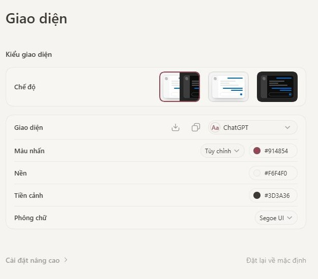
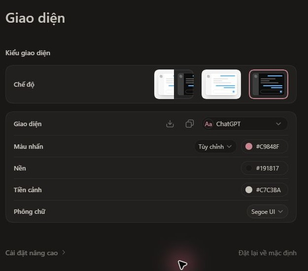

# Serein for Codex — Minimalist Warm Theme for AI & Code Workflows

**Extreme minimalism. Everyday comfort.**

Serein for Codex brings the clean, eye-friendly Serein design system to Codex AI workspaces. Eliminate glaring neon contrasts when reviewing AI-generated code and chat prompts:

- **Serein Alabaster (Light):** Soft ivory workspace canvas with comfortable dark text for daytime development.
- **Serein Obsidian (Dark):** Muted charcoal background with warm tones for nighttime thinking and debugging.

[Download Latest Release](https://github.com/cmduyeen/serein-codex/releases/latest) · [Full Serein Suite](https://github.com/cmduyeen/serein-theme) · [Read Workflow Guide](https://cmduyeen.github.io/)

---

## Preview

| Serein Alabaster · Light Mode | Serein Obsidian · Dark Mode |
|---|---|
|  |  |

---

## Installation

1. Run `./copy-theme.ps1 -Mode Light` (or `-Mode Dark`) to copy the theme JSON configuration to your clipboard.
2. In Codex, navigate to **Settings → Appearance**.
3. Under the corresponding theme slot (Light or Dark), click **Import**.
4. Paste the theme configuration and apply.

*(Tip: Export or copy your existing theme first if you want to restore it later.)*

---

## Complete the Serein Workspace

Synchronize your AI environment with your code editors and system:

- 💻 **[Serein for VS Code](https://github.com/cmduyeen/serein-vscode)** — Clean code editor theme.
- 💻 **[Serein for Neovim](https://github.com/cmduyeen/serein-neovim)** — Native Lua terminal colorscheme.
- 🖥️ **[Serein for Windows Terminal](https://github.com/cmduyeen/serein-terminal)** — Warm console color scheme.
- 📓 **[Serein for Obsidian](https://github.com/cmduyeen/serein-obsidian)** — Distraction-free markdown notes.
- 🌐 **[All 10+ Serein Ports](https://github.com/cmduyeen/serein-theme)** — The central hub and design specifications.

---

## Honest Design & Limitations

Themes are aesthetic preferences and visual comfort tools, not medical treatments. Serein has not been clinically tested to treat eye strain. Ambient lighting, glare control, and regular breaks remain essential.
- [American Academy of Ophthalmology: Computer Usage Guidance](https://www.aao.org/eye-health/diseases/computer-usage)
- [Full design reference & limitations](https://github.com/cmduyeen/serein-theme/blob/main/REFERENCE.md)

---

## Author & License

Created and maintained by **[Dyn (cmduyeen)](https://cmduyeen.github.io/)**.
- Personal Blog: [cmduyeen.github.io](https://cmduyeen.github.io/)
- GitHub: [@cmduyeen](https://github.com/cmduyeen)

Released under the [MIT License](LICENSE).
